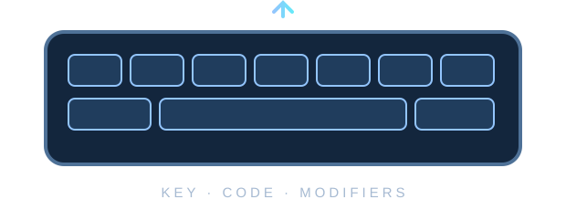

<p align="center">
  
  <br/>
  <br/>   
  <br/>
</p>

## 🧭 Overview

Keyboard Event Inspector is a local browser tool for understanding keyboard events. Type in the test area to compare the logical `key`, physical `code`, modifier flags, repeat state, and composition lifecycle.

## ✨ Features

- ⌨️ Inspect `keydown` and `keyup` events.
- 🧭 Compare `event.key` with `event.code` and key location.
- 🎛️ See Shift, Control, Alt, Meta, repeat, and composition flags.
- 🌐 Observe IME composition start, update, and end events.
- 🔒 No event is sent to a server or saved to browser storage.

## 🎬 Demo

Run the app, focus the test area, and press a few keys. The event table updates locally. Avoid typing passwords or other secrets into the test area. No hosted demo is claimed.

## 🚀 Quick Start

Requires Node.js 18 or newer.

```bash
npm start
```

Open http://localhost:4173.

## 🧰 Tech Stack

- 🟢 Node.js built-in HTTP server
- 🌐 HTML, CSS, and browser KeyboardEvent APIs
- 📦 No third-party dependencies

## 🗂️ Folder Structure

```text
keyboard-event-inspector/
├── assets/mark.svg
├── app.js
├── index.html
├── server.js
├── package.json
├── README.md
├── LICENSE
└── .gitignore
```

## 🛣️ Roadmap

- [ ] Add a printable keyboard layout view.
- [ ] Add optional beforeinput and input event panels.
- [ ] Add export of a sanitized event trace.

## 🤝 Contributing

Include browser and operating-system details when reporting behavior differences. Keep the inspector passive: it must not block normal keyboard input.

## 📄 License

MIT licensed. See [LICENSE](LICENSE).

<p align="center"></p>
